Welcome to the most efficient keyboard layout in the universe

## OS modes (Mac first)

The base layout and all combos send **macOS** shortcuts (Cmd copy/paste/undo/tabs, Option word-delete, Cmd+Tab app switching, Ctrl+Left/Right Spaces, Ctrl+Up Mission Control, Ctrl+Cmd+Q lock, Cmd+Shift+4/5 screenshots, Cmd+Up/Down page top/bottom, Cmd+[ / ] back/forward).

To use the **Windows** shortcuts, press the top-left and top-right keys together (combo on positions 0 + 11). This toggles layer 7 (and swaps the scroll/function layers for their Windows versions). Press it again to return to Mac. The state is not saved across power cycles, so the board always boots in Mac mode.
